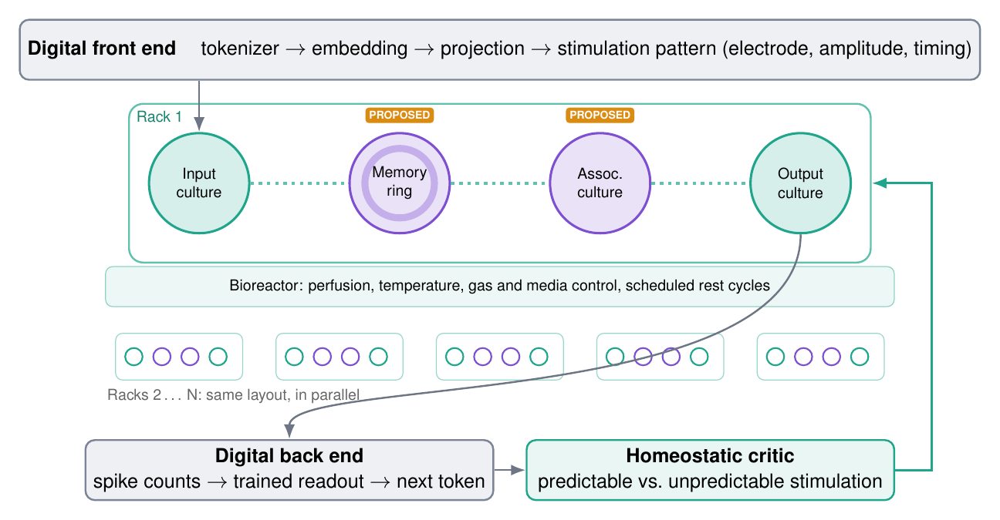
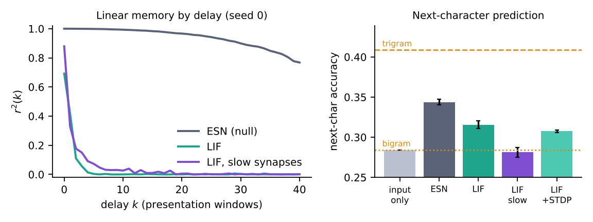

# Wetware LLM, in silico

**Can living neurons run part of a language model? A falsifiable test, run in simulation first.**

This repository contains the code, raw results and preprint for:

> **The Cellular Data Center: An In-Silico, Falsifiable Blueprint for Language Machines Built on Living Neural Tissue**
> Md Rejaul Korim Sadi, Azuhad Islam Ruhan, Dewan Fahad Chowdhury (2026). Preprint: [`paper/Cellular_Data_Center_preprint.pdf`](paper/Cellular_Data_Center_preprint.pdf)

No living tissue is used here. Every neuron in this repository is simulated.

---

## Why this exists

In 2022, cortical neurons on a multi-electrode array learned a simplified Pong game within five minutes of closed-loop play ([DishBrain, Kagan et al., *Neuron*](https://doi.org/10.1016/j.neuron.2022.09.001)). Living neurons on chips can now be bought or rented over the cloud. The human brain runs on about 20 W. Data centers used about 415 TWh of electricity in 2024 (IEA).

So the question is fair. But it is also easy to answer badly: the silicon decoder can quietly do all the work while the cells take the credit. This project is built to catch that.

## The idea: a cellular data center



| Part | Made of | What it does |
|---|---|---|
| Digital front end | silicon | tokens to stimulation patterns (which electrodes, how strong, when) |
| Input culture | tissue | receives the pulses |
| Memory ring | tissue, **proposed** | a looped culture meant to hold recent context |
| Association culture | tissue, **proposed** | meant to mix and relate patterns |
| Output culture | tissue | produces the spikes that are read |
| Bioreactor | life support | feeding, temperature, gas, scheduled rest |
| Racks 2 to N | tissue | the same layout, in parallel |
| Digital back end | silicon | spike counts to a trained readout to the next token |
| Homeostatic critic | silicon | predictable stimulation when right, random stimulation at safe levels when wrong |

Version 1 is a **reservoir hybrid**. The tissue is never trained directly; only the linear readout is.

## The one hard rule

> If a random echo state network of the **same size**, with the **same readout** and the **same budget**, does at least as well, the biology is not contributing.

That is the null model (H0). The paper states four more falsifiable hypotheses (memory ring, closed-loop learning, scale-out across racks, energy per token).

## First result: the null model held

Pilot: 500 units per substrate, 5 seeds, 3 tasks. Every substrate gets the same ridge-regression readout.

| Substrate | Memory capacity (higher is better) | Mackey-Glass error, NRMSE (lower is better) | Next-character accuracy (higher is better) |
|---|---|---|---|
| Input only (no reservoir) | 0.10 ± 0.00 | 0.658 ± 0.002 | 0.284 ± 0.000 |
| **Echo state network (null model)** | **49.23 ± 0.62** | **0.005 ± 0.005** | **0.344 ± 0.003** |
| Spiking reservoir (LIF, frozen) | 0.80 ± 0.07 | 0.752 ± 0.010 | 0.316 ± 0.005 |
| Spiking, slow synapses (50 ms) | 1.44 ± 0.23 | 0.307 ± 0.013 | 0.281 ± 0.006 |
| Spiking after STDP exposure | 1.13 ± 0.09 | 0.673 ± 0.019 | 0.307 ± 0.002 |

Count-based references on the same text split: unigram 0.196, bigram 0.284, trigram 0.409.



**What it means**

- The plain silicon reservoir won every task. H0 is **not** rejected at this scale.
- The spiking network did carry some context: it beat the input-only readout on next-character prediction (0.316 vs 0.284).
- Its memory faded within about three presentation windows (about 45 ms).
- Slower synapses nearly doubled memory but made next-character prediction worse.

**The takeaway:** the first engineering problem for wetware language machines is **time scale, not neuron count**. The tissue's clock has to match the clock of language.

### A first look at the memory ring

Single seed, sum of memory r² for delays 1 to 11:

| Configuration | Memory | Mean firing rate (Hz) |
|---|---|---|
| 2D wiring (baseline) | 0.45 | 5.3 |
| 2D wiring, slow synapses (50 ms) | 1.10 | 28.7 |
| Ring, weight 0.1 | 0.49 | 0.5 |
| Ring, weight 0.2 | 0.07 | 7.8 |
| Ring, weight 0.5 | 0.14 | 54.0 |
| Ring, weight 1.0 | 0.05 | 148.0 |

A naively wired ring did not help. A memory ring needs the right time scale and excitation-inhibition balance, not just the topology.

## What this project does not claim

- No culture of "billions of neurons". DishBrain-style cultures are seeded with about one million cells.
- No high-voltage "punishment". Feedback stays in the safe range used in published work.
- The memory ring and association culture are hypotheses, not mechanisms.
- A simulation cannot prove that real neurons behave the same way.

## Reproduce everything

**Requirements:** Python 3.10 or newer, `numpy`, `matplotlib`. No GPU needed.

```
pip install -r requirements.txt
```

**Data:** download Tiny Shakespeare and save it in this folder as `tinyshakespeare.txt`:
https://raw.githubusercontent.com/karpathy/char-rnn/master/data/tinyshakespeare/input.txt
(SHA-256 `86c4e6aa9db7c042ec79f339dcb96d42b0075e16b8fc2e86bf0ca57e2dc565ed`)

**Run in this order:**

| Step | Command | Output | Time (2 CPU cores) |
|---|---|---|---|
| 1 | `python tune.py` | `results/tune_results.json` | a few minutes |
| 2 | `python pilot.py` | `results/pilot_results.json` | about 25 min |
| 3 | `python curves.py` | `results/curves.json` | about 1 min |
| 4 | `python ring_probe.py` | `results/ring_probe.json` | about 1 min |
| 5 | `python make_results.py` | `results.tex`, `fig_pilot.pdf`, `docs/pilot_results.png` | seconds |

`python pilot.py --quick` runs 3 seeds instead of 5. All runs are seeded and deterministic.

## Method in brief

| | Echo state network | Spiking reservoir (LIF) |
|---|---|---|
| Units | 500 tanh units, 10% connectivity | 500 leaky integrate-and-fire neurons, 80% excitatory / 20% inhibitory |
| Wiring | random, spectral radius 1.05 | random 2D "dish", distance-dependent |
| Time | one update per input | 1 ms steps, 15 ms per input, membrane 20 ms, synapse 5 ms (or 50 ms) |
| Input | random weights, scale 0.1 | each symbol drives its own random group of neurons (an "electrode footprint") |
| Features | unit states | spike traces, low-pass filtered at 20 ms |
| Tuning | 3x3 grid on seed 99 | 3x3 grid on seed 99 |
| Readout | ridge regression, penalty chosen on validation | same |

**Tasks**
- Linear memory capacity (Jaeger, 2001), delays 1 to 80
- Mackey-Glass (tau 17), predicting 5 steps ahead
- Next-character prediction on 40,000 characters of Tiny Shakespeare, 27 symbols

## Repository layout

```
pilot.py          substrates (ESN, LIF, LIF + STDP), tasks, main benchmark
tune.py           equal-size hyper-parameter grids for ESN and LIF
curves.py         memory by delay, for the figure
ring_probe.py     memory-ring probe
probe.py          helper used by ring_probe.py
make_results.py   tables and figure from the JSON results
results/          raw JSON outputs
docs/             architecture diagram and results figure
paper/            preprint PDF
```

## Roadmap

- [x] Architecture, hypotheses and null model
- [x] Pilot at N = 500 (this repository)
- [ ] Full protocol in Brian2 at 2,000 to 10,000 neurons
- [ ] Small LSTM upper reference
- [ ] Memory-ring and multi-rack ablations
- [ ] Closed-loop critic versus frozen reservoir
- [ ] Real-tissue data, if a wetware lab or platform partners with us

## Work with us

If you build in wetware, organoid computing or neuromorphic hardware, we would like to hear from you: feedback on the design, access to real tissue data, or where it breaks.
Contact: Md Rejaul Korim Sadi, rejaulkorimsadi@gmail.com

## Citation

```bibtex
@misc{sadi2026cellular,
  title  = {The Cellular Data Center: An In-Silico, Falsifiable Blueprint for Language Machines Built on Living Neural Tissue},
  author = {Sadi, Md Rejaul Korim and Ruhan, Azuhad Islam and Chowdhury, Dewan Fahad},
  year   = {2026},
  note   = {Preprint}
}
```

## License

MIT. See [LICENSE](LICENSE).
